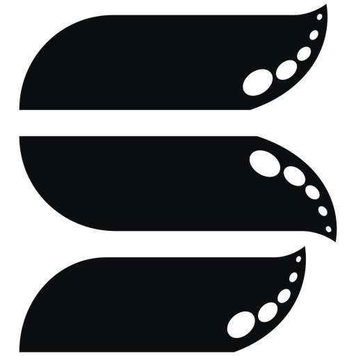

<p align="center">
  <picture>
    <source media="(prefers-color-scheme: dark)" srcset="brand/logo-white.png">
    
  </picture>
</p>

<h1 align="center">SteadyScreen</h1>

<p align="center">Compartilhe sua tela com os amigos direto do navegador, sem instalar nada.</p>

Você cria uma sala, escolhe a tela e manda o link. Quem abrir já começa a assistir.
Por enquanto dá para até 5 pessoas assistirem ao mesmo tempo.

## Como funciona

O vídeo vai direto do seu navegador para o de quem está assistindo (WebRTC). O servidor só ajuda
os navegadores a se encontrarem, ele não recebe o vídeo.

```
Quem compartilha (navegador)            Servidor Go (server/)             Quem assiste (navegador)
  getDisplayMedia ─┐                 ┌─ salas e links (API REST)
                   └── sinalização ──┤                                ┌── sinalização
                       (WebSocket)   └─ repassa offer/answer/ICE ─────┘
  RTCPeerConnection ════════════ vídeo e áudio direto (WebRTC P2P) ════════ <video>
```

| Pasta | O que tem |
|---|---|
| `web/` | O site, em Next.js + TypeScript |
| `server/` | O servidor, em Go: cria as salas, os links e conecta as pessoas |

Toda a parte de transmissão fica em `web/src/lib/host.ts` e `web/src/lib/viewer.ts`. Mais pra frente
ela vai passar por um servidor em Go que distribui o vídeo (SFU), e aí o limite de 5 pessoas acaba.

## Rodando no seu PC

Você vai precisar do [Node.js](https://nodejs.org) 20+ e do [Go](https://go.dev/dl) 1.23+.

**1. Servidor** (num terminal):

```bash
cd server
go mod tidy
go run .
```

**2. Site** (em outro terminal):

```bash
cd web
npm install
npm run dev
```

Abra http://localhost:3000, clique em **Crie sua sala**, depois em **Escolher tela**, e abra o link da sala em outra aba.

### Assistindo de outro PC na mesma rede

Troque `localhost` pelo IP do seu PC no link da sala (tipo `http://192.168.0.10:3000/sala/abc123`).
Quem compartilha tem que estar em `localhost` ou em HTTPS, porque só assim o navegador deixa capturar
a tela. Quem assiste pode usar o IP de boa. Se o Windows perguntar, libera as portas 3000 e 8080 no firewall.

## Configurando o servidor

| Variável | Padrão | Para que serve |
|---|---|---|
| `ADDR` | `:8080` | Endereço e porta |
| `MAX_VIEWERS` | `5` | Quantas pessoas podem assistir por sala |
| `ALLOWED_ORIGINS` | *(vazio = qualquer um)* | Sites que podem usar a API, separados por vírgula. Em produção, preencha. |
| `STUN_URLS` | `stun:stun.l.google.com:19302` | Servidores STUN |
| `TURN_URLS`, `TURN_USERNAME`, `TURN_CREDENTIAL` | *(vazio)* | Servidor TURN (coturn), precisa na VPS |

No site, `NEXT_PUBLIC_SERVER_URL` diz onde está o servidor (se não colocar nada, usa o mesmo endereço na porta 8080).

## Próximos passos

- [x] Compartilhar pelo navegador, até 5 pessoas, rodando no PC
- [ ] Colocar no ar numa VPS, com domínio, HTTPS e TURN (coturn)
- [ ] Servidor de vídeo em Go (Pion) para tirar o limite de 5; captura com Sunshine + NVENC/AMF no PC de quem compartilha
- [ ] App para PC com captura própria, controle remoto de mouse e teclado e instalador

## Licença

[GPL-3.0](LICENSE)
